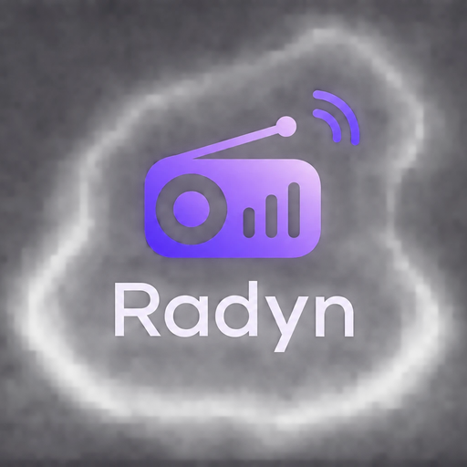
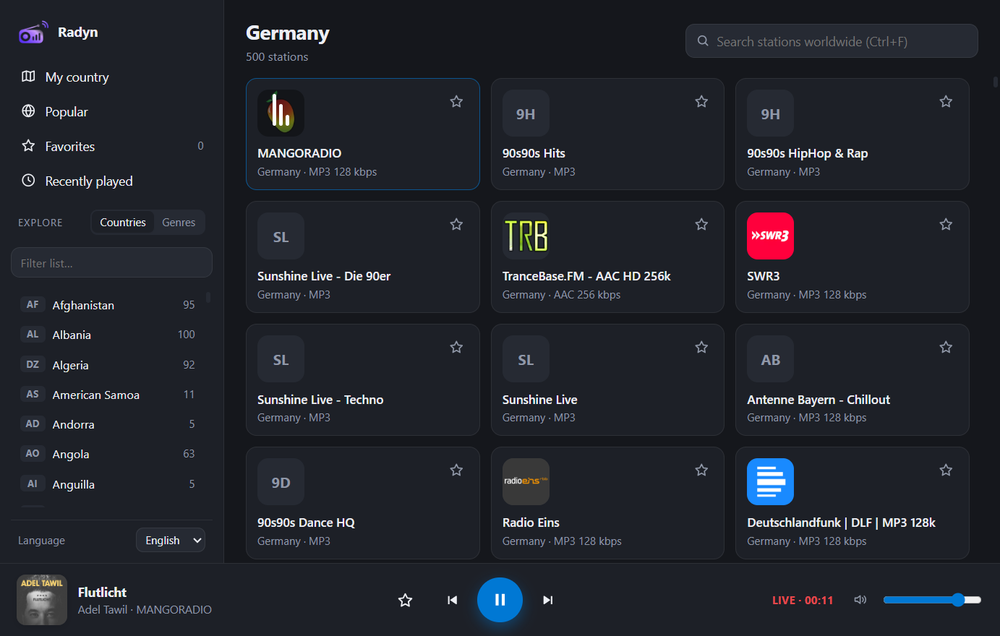
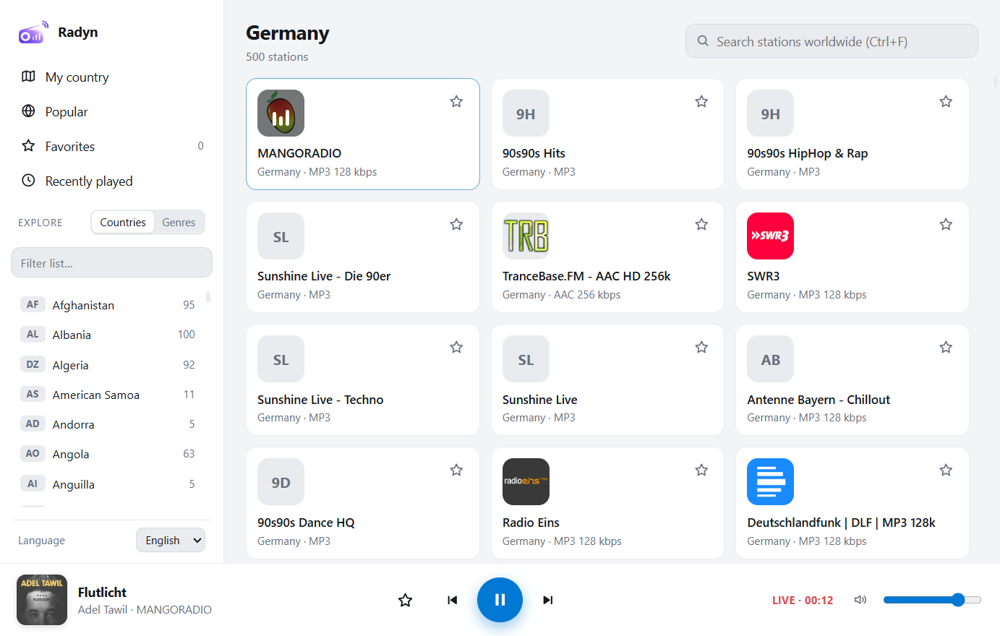

<p align="center">
  
</p>

<h1 align="center">Radyn</h1>

<p align="center">
  Live radio from around the world, in one lightweight desktop app.<br>
  Browse by country and genre, search 50,000+ stations, see what's playing, and control everything from your taskbar.
</p>

<p align="center">
  <a href="https://github.com/Kurenai10/radyn/releases/latest"></a>
  <a href="https://github.com/Kurenai10/radyn/actions/workflows/release.yml"></a>
  
  
</p>

<p align="center">
  <strong>English</strong> · <a href="README.tr.md">Türkçe</a>
</p>

---

<p align="center">
  <br><br>
  
</p>

## Features

- 🌍 **50,000+ stations** from the open [Radio Browser](https://www.radio-browser.info/) database. Only working stations are listed.
- 📍 **Your country first:** on launch, Radyn detects your country and shows its stations.
- 🗺️ **Countries and genres:** 224 countries (names in your language) and the 80 most common genres, plus worldwide search.
- ⭐ **Favorites and history:** save stations and find recently played ones. Everything persists between sessions.
- 🎵 **Now playing:** station logo, the song and artist sent by the stream (ICY or HLS ID3 metadata), and album art when it can be matched.
- 🔊 **Solid playback:** one connection per stream, automatic reconnection, mute with a key, and a remembered volume.
- 🪟 **Windows taskbar:** Previous, Play/Stop and Next buttons on the taskbar preview, a jump list, and the current station in the tooltip.
- 🐧 **Linux desktop:** MPRIS support for media panels and lock screens, plus a one-command installer.
- 🌐 **Five languages:** English, Türkçe, Deutsch, Français, Español. Starts in your system language.
- 🎨 **Native look:** follows Windows light/dark mode and accent color.

## Download

| Platform | File | Notes |
|---|---|---|
| Windows 10/11 (x64) | `Radyn-Setup-<version>.exe` | Installer. Per-user, no admin rights needed. Currently unsigned. |
| Linux (x64) | `Radyn-<version>.AppImage` | Portable; runs on most distributions. |
| Linux (x64) | `radyn_<version>_amd64.deb` | For Debian and Ubuntu. |
| Linux (x64) | `install-radyn.sh` | One-command installer (see below). |

Every release includes `SHA256SUMS.txt`. Verify your download before you run it.

**[→ Latest release](https://github.com/Kurenai10/radyn/releases/latest)**

## Installation

### Windows

1. Download `Radyn-Setup-<version>.exe` from the [latest release](https://github.com/Kurenai10/radyn/releases/latest).
2. Run it. Windows may show **"Windows protected your PC"** because the installer is not code-signed. Click **More info → Run anyway**.
3. Radyn installs to `%LOCALAPPDATA%\Programs\Radyn`. Launch it from the Start menu.

To verify the checksum in PowerShell:

```powershell
Get-FileHash .\Radyn-Setup-1.1.0.exe -Algorithm SHA256
```

### Linux

**Option A: one-command installer (recommended).** It downloads the latest AppImage, verifies its SHA-256 checksum, installs it under `~/.local/share/radyn`, and adds a menu entry. No root access needed.

```bash
curl -fsSLO https://github.com/Kurenai10/radyn/releases/latest/download/install-radyn.sh
bash install-radyn.sh
```

Other options:

```bash
bash install-radyn.sh --version v1.1.0   # install a specific version
bash install-radyn.sh --uninstall        # remove the app (settings are kept)
```

**Option B: AppImage or .deb by hand.**

```bash
sha256sum -c SHA256SUMS.txt --ignore-missing

# AppImage
chmod +x Radyn-1.1.0.AppImage && ./Radyn-1.1.0.AppImage

# .deb (Debian/Ubuntu)
sudo apt install ./radyn_1.1.0_amd64.deb
```

**Option C: from source** (Node.js 20 or newer):

```bash
git clone https://github.com/Kurenai10/radyn.git
cd radyn
npm install
npm start
```

## Usage

- **Start:** Radyn opens on **My country**. Use the sidebar for **Popular**, **Favorites** and **Recently played**.
- **Browse:** pick a country or genre in the *Explore* panel, or search by station name with `Ctrl+F`.
- **Play:** click a card (or press Enter on it). The ★ on a card saves the station to favorites.
- **Controls:** play/stop, previous and next station within the current list, and mute with the speaker icon or `M`.
- **Window:** closing the window hides Radyn to the tray and playback continues. Quit from the tray menu. Starting Radyn again brings the open window forward.

### Windows taskbar

- Hover over the Radyn taskbar button to see the thumbnail preview with **Previous**, **Play/Stop** and **Next** buttons.
- Right-click the taskbar button for the jump list: **Play / Stop**, **Previous station**, **Next station**. If Radyn is closed, these start it and run the command.

### Keyboard shortcuts

| Key | Action |
|---|---|
| `Space` | Play / stop |
| `←` / `→` | Previous / next station |
| `M` | Mute / unmute |
| `Ctrl+F` | Focus the search box |
| `Enter` | Play the focused card (on the ★ button, toggles the favorite) |
| Media keys | Play/pause, next, previous, stop (system-wide) |

## Languages

Radyn starts in your system language if it is supported (English, Türkçe, Deutsch, Français, Español); otherwise it uses English. Change it with the **Language** selector at the bottom of the sidebar. The choice is saved, and the taskbar, jump list and tray menu follow it. Country names are localized; station names and genres come from the station catalog.

## Data and privacy

Everything is stored locally in one JSON file:

| OS | Location |
|---|---|
| Windows | `%APPDATA%\Radyn\veri.json` |
| Linux | `~/.config/Radyn/veri.json` |

It holds your favorites, recently played stations, volume and language. To reset Radyn, close it and delete the file.

Radyn has no accounts, analytics or telemetry. It talks to these services:

| Service | When | What is sent |
|---|---|---|
| `*.api.radio-browser.info` | Browsing, searching, play counter | Search terms, country codes, station IDs |
| `ipapi.co`, `ipwho.is` | Once per launch | **Your IP address**. Only the country code is returned. |
| `itunes.apple.com` | When a new song is detected | Artist and song title, to find album art |
| The station's own stream | While playing | Standard HTTP or HLS requests |

The stream passes through a local relay on `127.0.0.1` inside the app. To skip the country lookup, change `showView('home')` to `showView('top')` in `init` in `renderer/app.js`.

## Troubleshooting

<details>
<summary><strong>Windows says "Windows protected your PC"</strong></summary>

The installer is not signed with a code-signing certificate. Click **More info → Run anyway**. Verify the SHA-256 checksum first if you want to be sure the file is intact.
</details>

<details>
<summary><strong>A station shows "Connection failed"</strong></summary>

Radyn retried three times. Common causes: the station is offline (try another one), a firewall blocks the stream port, the station is restricted to certain regions (try with or without a VPN), or the stream format is unsupported.
</details>

<details>
<summary><strong>No sound, but the player is running</strong></summary>

Check that Radyn is not muted (speaker icon, or press `M`), that the volume slider is up, that the Windows Volume Mixer has not muted Radyn, and that the right output device is selected. On Linux, confirm PipeWire or PulseAudio is running.
</details>

<details>
<summary><strong>"Radio database unreachable" or an empty list</strong></summary>

The Radio Browser servers could not be reached. Check your internet connection and any firewall or proxy rules for `*.api.radio-browser.info`. Radyn tries three mirrors in turn; retry in a few minutes if they are busy.
</details>

<details>
<summary><strong>No song title or album art</strong></summary>

Song titles appear only when the stream sends metadata (most Shoutcast/Icecast MP3 and AAC streams do; HLS streams only when they carry ID3 tags). Album art needs an exact artist and title match in the iTunes catalog; without a match the station logo is shown.
</details>

<details>
<summary><strong>Taskbar buttons or the jump list are missing</strong></summary>

Hover over the taskbar button to see the thumbnail preview; the buttons appear in it. The jump list appears on right-click. Both need Radyn to have been started at least once. If the window is hidden in the tray, the taskbar button is not shown: use the tray menu to show the window.
</details>

<details>
<summary><strong>Linux: "No usable sandbox!" or the app closes immediately</strong></summary>

Ubuntu 24.04 and similar distributions can restrict unprivileged user namespaces with AppArmor. `install-radyn.sh` detects this and starts Radyn with `--no-sandbox`, which lowers one layer of protection. The safer fix is an AppArmor profile for Electron, set up with your system administrator. Start the app from a terminal to see the exact error.
</details>

<details>
<summary><strong>Linux: "error while loading shared libraries: libXXX.so"</strong></summary>

A system library is missing. On Debian or Ubuntu, a common set is:

```bash
sudo apt install libnss3 libatk-bridge2.0-0 libgtk-3-0 libasound2 libxss1 libgbm1 libdrm2 libxkbcommon0 libxcomposite1 libxdamage1 libxrandr2
```
</details>

<details>
<summary><strong>Linux: the AppImage will not start (FUSE error)</strong></summary>

Install `libfuse2` (`sudo apt install libfuse2`, or `sudo dnf install fuse-libs` on Fedora), or run the AppImage with `APPIMAGE_EXTRACT_AND_RUN=1 ./Radyn-1.1.0.AppImage`.
</details>

<details>
<summary><strong>Linux: no tray icon on GNOME</strong></summary>

GNOME needs the **AppIndicator and KStatusNotifierItem Support** extension for tray icons. The app works without it.
</details>

**Still stuck?** [Open an issue](https://github.com/Kurenai10/radyn/issues/new/choose) with your OS, the Radyn version, what you did, the exact error text, and the relevant terminal output (`npm start` prints it).

## Development

### Requirements

- Node.js 20 or newer
- Windows 10/11 or Linux (x64)

### Commands

| Command | What it does |
|---|---|
| `npm install` | Install dependencies and Electron |
| `npm start` | Run the app in development mode |
| `npm test` | Run the 37 unit and integration tests |
| `npm run icons` | Regenerate the icon and taskbar button images |
| `npm run dist:win` | Build the Windows installer into `dist/` |
| `npm run dist:linux` | Build the AppImage and `.deb` (run on Linux) |

If Electron cannot download from GitHub, point `npm install` at your mirror: `ELECTRON_MIRROR=https://your-mirror/electron/ npm install`.

### Project structure

```
main.js                  Main process: window, tray, taskbar, jump list, media keys, IPC
preload.js               Narrow bridge exposed to the renderer (window.radio)
install-radyn.sh         Linux installer (downloads and verifies the latest AppImage)
src/
  radio-api.js           Radio Browser client with mirror fallback
  stream-proxy.js        Local audio relay: one connection, metadata split, single-use URLs
  icy.js                 ICY metadata parser
  id3.js                 ID3 reader for HLS streams (runs in Node and in the renderer)
  strings.js             Translations for all five languages
  art.js                 Album art lookup (iTunes Search) with match checks and a cache
  geo.js                 Country detection by IP, with an OS locale fallback
  store.js               Favorites, history and settings (atomic JSON writes)
  mpris.js               Linux MPRIS integration (optional)
renderer/                UI: index.html, app.js, styles.css
assets/                  Icons and taskbar button images
packaging/               Linux desktop entry template
scripts/                 Icon generator and a local Linux install script
test/                    node:test suites
.github/workflows/       Release pipeline
```

### How it works

- The **renderer** has no Node or Electron access. It talks to the main process only through `preload.js`. Context isolation and the sandbox are enabled, and a Content Security Policy is set.
- **Streams** pass through a local relay in the main process. It reads the station once, strips the ICY metadata, forwards the audio unchanged, and passes song titles to the app. HLS streams play through hls.js, and their ID3 tags are read in the renderer.
- **One source of truth:** the renderer reports its playback state to the main process, which updates the window title, tray tooltip, taskbar buttons, jump list and MPRIS from that single state.

### Release process

Pushing a tag such as `v1.2.0` runs `.github/workflows/release.yml`. It runs the tests, builds the Windows installer and the Linux packages, runs a 30-second smoke test of the Linux build under a virtual display, generates `SHA256SUMS.txt`, and publishes the release.

### Code signing

The Windows installer is currently unsigned. The workflow signs it automatically when two repository secrets are set: `WIN_CSC_LINK` (base64-encoded `.pfx` certificate) and `WIN_CSC_KEY_PASSWORD`. Without them the build still succeeds, unsigned.

## Known limitations

- Song titles depend on the stream sending metadata. HLS streams are supported only when they carry ID3 tags.
- Album art comes from the iTunes catalog and is not always found.
- The station catalog is community-maintained; some stations may be offline.
- Live streams cannot be paused. Stopping and starting again reconnects to the live feed.
- The GNOME tray icon needs an extension.
- The Windows installer is unsigned, so SmartScreen warns on first run.

## Contributing

Bug reports, feature ideas and pull requests are welcome. See [CONTRIBUTING.md](CONTRIBUTING.md) to get started.

## License

No license has been chosen yet. Until one is added, all rights are reserved by the author.
