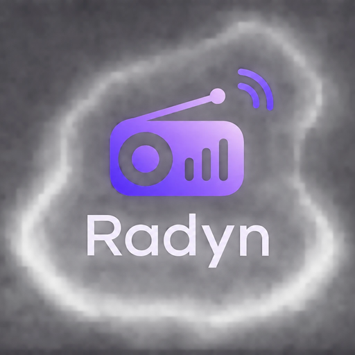
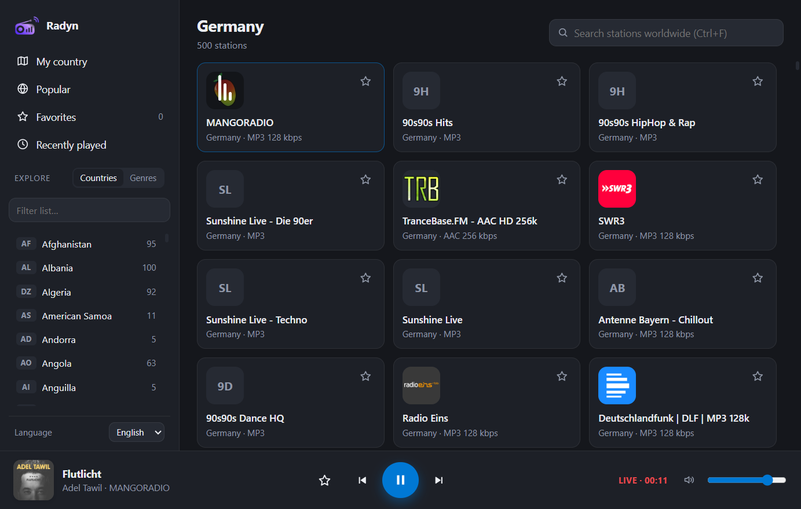
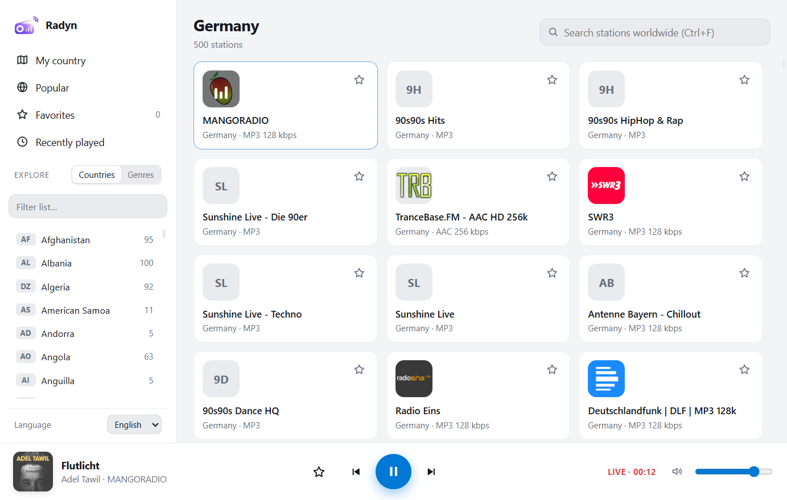

<p align="center">
  
</p>

<h1 align="center">Radyn</h1>

<p align="center">
  Dünyanın dört bir yanından canlı radyo, tek ve hafif bir masaüstü uygulamasında.<br>
  Ülke ve türe göre göz atın, 50.000'den fazla istasyonda arama yapın, o an ne çaldığını görün ve her şeyi görev çubuğunuzdan yönetin.
</p>

<p align="center">
  <a href="https://github.com/Kurenai10/radyn/releases/latest"></a>
  <a href="https://github.com/Kurenai10/radyn/actions/workflows/release.yml"></a>
  
  
</p>

<p align="center">
  <a href="README.md">English</a> · <strong>Türkçe</strong>
</p>

---

<p align="center">
  <br><br>
  
</p>

## Özellikler

- 🌍 **50.000'den fazla istasyon**, açık [Radio Browser](https://www.radio-browser.info/) veritabanından. Yalnızca çalışan istasyonlar listelenir.
- 📍 **Önce bulunduğunuz ülke:** açılışta Radyn ülkenizi bulur ve o ülkenin istasyonlarını gösterir.
- 🗺️ **Ülkeler ve türler:** 224 ülke (adları sizin dilinizde) ve en yaygın 80 tür; dünya genelinde arama.
- ⭐ **Favoriler ve geçmiş:** istasyonları kaydedin, son dinlediklerinizi bulun. Her şey oturumlar arasında saklanır.
- 🎵 **Şu an çalan:** istasyon logosu, yayının gönderdiği şarkı ve sanatçı (ICY veya HLS ID3 metadatası) ve eşleşirse albüm kapağı.
- 🔊 **Sağlam oynatma:** yayın başına tek bağlantı, otomatik yeniden bağlanma, tuşla sessize alma ve hatırlanan ses seviyesi.
- 🪟 **Windows görev çubuğu:** önizlemede Önceki, Oynat/Durdur ve Sonraki düğmeleri, jump list ve ipucunda çalan istasyon.
- 🐧 **Linux masaüstü:** medya panelleri ve kilit ekranı için MPRIS desteği, tek komutla kurulum.
- 🌐 **Beş dil:** English, Türkçe, Deutsch, Français, Español. Sistem dilinizle başlar.
- 🎨 **Yerel görünüm:** Windows'un açık/koyu modunu ve vurgu rengini izler.

## İndirme

| Platform | Dosya | Notlar |
|---|---|---|
| Windows 10/11 (x64) | `Radyn-Setup-<sürüm>.exe` | Kurulum dosyası. Kullanıcı bazlı, yönetici hakkı gerekmez. Şu an imzasız. |
| Linux (x64) | `Radyn-<sürüm>.AppImage` | Taşınabilir; çoğu dağıtımda çalışır. |
| Linux (x64) | `radyn_<sürüm>_amd64.deb` | Debian ve Ubuntu için. |
| Linux (x64) | `install-radyn.sh` | Tek komutla kurulum betiği (aşağıya bakın). |

Her sürümde `SHA256SUMS.txt` bulunur. İndirdiğiniz dosyayı çalıştırmadan önce doğrulayın.

**[→ Son sürüm](https://github.com/Kurenai10/radyn/releases/latest)**

## Kurulum

### Windows

1. [Son sürümden](https://github.com/Kurenai10/radyn/releases/latest) `Radyn-Setup-<sürüm>.exe` dosyasını indirin.
2. Çalıştırın. Kurulum dosyası kod imzası taşımadığı için Windows **"Windows PC'nizi korudu"** uyarısı gösterebilir. **Ek bilgi → Yine de çalıştır** seçin.
3. Radyn `%LOCALAPPDATA%\Programs\Radyn` klasörüne kurulur. Başlat menüsünden açın.

Sağlama toplamını PowerShell'de doğrulamak için:

```powershell
Get-FileHash .\Radyn-Setup-1.1.0.exe -Algorithm SHA256
```

### Linux

**A seçeneği: tek komutla kurulum (önerilen).** En son AppImage dosyasını indirir, SHA-256 özetini doğrular, `~/.local/share/radyn` altına kurar ve uygulama menüsüne ekler. Kök yetkisi gerekmez.

```bash
curl -fsSLO https://github.com/Kurenai10/radyn/releases/latest/download/install-radyn.sh
bash install-radyn.sh
```

Diğer seçenekler:

```bash
bash install-radyn.sh --version v1.1.0   # belirli bir sürümü kur
bash install-radyn.sh --uninstall        # uygulamayı kaldır (ayarlar korunur)
```

**B seçeneği: AppImage veya .deb'i elle kurmak.**

```bash
sha256sum -c SHA256SUMS.txt --ignore-missing

# AppImage
chmod +x Radyn-1.1.0.AppImage && ./Radyn-1.1.0.AppImage

# .deb (Debian/Ubuntu)
sudo apt install ./radyn_1.1.0_amd64.deb
```

**C seçeneği: kaynak koddan** (Node.js 20 veya üzeri):

```bash
git clone https://github.com/Kurenai10/radyn.git
cd radyn
npm install
npm start
```

## Kullanım

- **Başlangıç:** Radyn **Bulunduğum ülke** ile açılır. Kenar çubuğundan **Popüler**, **Favoriler** ve **Son dinlenenler** görünümlerine geçebilirsiniz.
- **Göz atma:** *Keşfet* panelinden bir ülke veya tür seçin ya da `Ctrl+F` ile istasyon adına göre arayın.
- **Çalma:** bir karta tıklayın (ya da odaktayken Enter'a basın). Karttaki ★, istasyonu favorilere ekler.
- **Denetimler:** oynat/durdur, geçerli listede önceki ve sonraki istasyon; ses simgesiyle veya `M` ile sessize alma.
- **Pencere:** pencereyi kapatmak Radyn'i tepsiye gizler ve yayın devam eder. Çıkış için tepsi menüsünü kullanın. Radyn'i tekrar açmak mevcut pencereyi öne getirir.

### Windows görev çubuğu

- Radyn'in görev çubuğu düğmesinin üzerine gelin: önizlemede **Önceki**, **Oynat/Durdur** ve **Sonraki** düğmeleri görünür.
- Jump list için görev çubuğu düğmesine sağ tıklayın: **Oynat / Durdur**, **Önceki istasyon**, **Sonraki istasyon**. Radyn kapalıysa bu komutlar uygulamayı açıp komutu çalıştırır.

### Klavye kısayolları

| Tuş | İşlev |
|---|---|
| `Boşluk` | Oynat / durdur |
| `←` / `→` | Önceki / sonraki istasyon |
| `M` | Sessize al / sesi aç |
| `Ctrl+F` | Arama kutusuna odaklan |
| `Enter` | Odaktaki kartı çal (★ düğmesindeyken favoriyi değiştirir) |
| Medya tuşları | Oynat/duraklat, sonraki, önceki, durdur (sistem genelinde) |

## Diller

Radyn, sistem diliniz destekleniyorsa (English, Türkçe, Deutsch, Français, Español) o dilde açılır; desteklenmiyorsa İngilizce kullanır. Kenar çubuğunun altındaki **Dil / Language** seçicisinden değiştirebilirsiniz. Seçim kaydedilir; görev çubuğu, jump list ve tepsi menüsü de bu dili izler. Ülke adları yerelleştirilir; istasyon adları ve türler kataloğun kendi metnidir.

## Veriler ve gizlilik

Her şey tek bir JSON dosyasında yerel olarak saklanır:

| İşletim sistemi | Konum |
|---|---|
| Windows | `%APPDATA%\Radyn\veri.json` |
| Linux | `~/.config/Radyn/veri.json` |

Dosyada favorileriniz, son dinlediğiniz istasyonlar, ses seviyeniz ve dil tercihiniz bulunur. Radyn'i sıfırlamak için kapatıp dosyayı silin.

Radyn hesap, analitik veya telemetri içermez. Şu servislerle iletişim kurar:

| Servis | Ne zaman | Gönderilen |
|---|---|---|
| `*.api.radio-browser.info` | Göz atma, arama, dinleme sayacı | Arama terimleri, ülke kodları, istasyon kimlikleri |
| `ipapi.co`, `ipwho.is` | Her açılışta bir kez | **IP adresiniz**. Yanıt olarak yalnızca ülke kodu döner. |
| `itunes.apple.com` | Yeni bir şarkı algılandığında | Albüm kapağını bulmak için sanatçı ve şarkı adı |
| İstasyonun kendi yayını | Çalarken | Standart HTTP veya HLS istekleri |

Yayın, uygulama içindeki `127.0.0.1` üzerindeki yerel aktarıcıdan geçer. Ülke sorgusunu atlamak isterseniz `renderer/app.js` içindeki `init` fonksiyonunda `showView('home')` çağrısını `showView('top')` ile değiştirin.

## Sorun giderme

<details>
<summary><strong>Windows "Windows PC'nizi korudu" diyor</strong></summary>

Kurulum dosyası kod imzalama sertifikasıyla imzalanmamış. **Ek bilgi → Yine de çalıştır** seçin. Dosyanın bozulmadığından emin olmak için önce SHA-256 sağlama toplamını doğrulayın.
</details>

<details>
<summary><strong>Bir istasyon "Bağlantı kurulamadı" diyor</strong></summary>

Radyn üç kez yeniden denedi. Yaygın nedenler: istasyon çevrimdışı (başka birini deneyin), güvenlik duvarı yayın portunu engelliyor, istasyon belirli bölgelerle sınırlı (VPN ile veya VPN'siz deneyin) ya da yayın formatı desteklenmiyor.
</details>

<details>
<summary><strong>Ses yok ama oynatıcı çalışıyor</strong></summary>

Radyn'in sessize alınmadığını (hoparlör simgesi veya `M`), ses kaydırıcısının açık olduğunu, Windows Ses Karıştırıcısı'nda Radyn'in kapalı olmadığını ve doğru çıkış aygıtının seçili olduğunu kontrol edin. Linux'ta PipeWire veya PulseAudio'nun çalıştığını doğrulayın.
</details>

<details>
<summary><strong>"Radyo veritabanına ulaşılamadı" ya da boş liste</strong></summary>

Radio Browser sunucularına ulaşılamadı. İnternet bağlantınızı ve `*.api.radio-browser.info` için güvenlik duvarı ya da proxy kurallarını kontrol edin. Radyn üç aynayı sırayla dener; meşgulse birkaç dakika sonra tekrar deneyin.
</details>

<details>
<summary><strong>Şarkı adı veya albüm kapağı yok</strong></summary>

Şarkı adı yalnızca yayın metadata gönderirse görünür (çoğu Shoutcast/Icecast MP3 ve AAC yayını gönderir; HLS yayınları yalnızca ID3 etiketi taşıyorsa). Albüm kapağı için iTunes kataloğunda sanatçı ve parça adının birebir eşleşmesi gerekir; eşleşme yoksa istasyon logosu gösterilir.
</details>

<details>
<summary><strong>Görev çubuğu düğmeleri veya jump list yok</strong></summary>

Önizlemeyi görmek için görev çubuğu düğmesinin üzerine gelin; düğmeler önizlemenin altında çıkar. Jump list sağ tıklamayla açılır. İkisi için Radyn'in en az bir kez açılmış olması gerekir. Pencere tepsiye gizliyse görev çubuğu düğmesi görünmez; pencereyi tepsi menüsünden gösterin.
</details>

<details>
<summary><strong>Linux: "No usable sandbox!" ya da uygulama hemen kapanıyor</strong></summary>

Ubuntu 24.04 ve benzeri dağıtımlar, ayrıcalıksız kullanıcı ad alanlarını AppArmor ile kısıtlayabilir. `install-radyn.sh` bunu algılar ve Radyn'i `--no-sandbox` ile başlatır; bu, bir koruma katmanını düşürür. Daha güvenli çözüm, sistem yöneticinizle birlikte Electron için bir AppArmor profili tanımlamaktır. Tam hatayı görmek için uygulamayı terminalden başlatın.
</details>

<details>
<summary><strong>Linux: "error while loading shared libraries: libXXX.so"</strong></summary>

Bir sistem kütüphanesi eksik. Debian veya Ubuntu'da sık gerekenler:

```bash
sudo apt install libnss3 libatk-bridge2.0-0 libgtk-3-0 libasound2 libxss1 libgbm1 libdrm2 libxkbcommon0 libxcomposite1 libxdamage1 libxrandr2
```
</details>

<details>
<summary><strong>Linux: AppImage açılmıyor (FUSE hatası)</strong></summary>

`libfuse2` kurun (`sudo apt install libfuse2`, Fedora'da `sudo dnf install fuse-libs`) ya da AppImage'ı `APPIMAGE_EXTRACT_AND_RUN=1 ./Radyn-1.1.0.AppImage` ile çalıştırın.
</details>

<details>
<summary><strong>Linux: GNOME'da tepsi simgesi yok</strong></summary>

GNOME tepsi simgeleri için **AppIndicator and KStatusNotifierItem Support** eklentisini ister. Uygulama eklenti olmadan da çalışır.
</details>

**Hâlâ çözemediniz mi?** İşletim sisteminizi, Radyn sürümünü, ne yaptığınızı, tam hata metnini ve ilgili terminal çıktısını ([`npm start`](#geliştirme) bunu yazdırır) içeren bir [sorun bildirin](https://github.com/Kurenai10/radyn/issues/new/choose).

## Geliştirme

### Gereksinimler

- Node.js 20 veya üzeri
- Windows 10/11 veya Linux (x64)

### Komutlar

| Komut | Ne yapar |
|---|---|
| `npm install` | Bağımlılıkları ve Electron'u kurar |
| `npm start` | Uygulamayı geliştirme modunda çalıştırır |
| `npm test` | 37 birim ve entegrasyon testini çalıştırır |
| `npm run icons` | Simge ve görev çubuğu düğmesi görsellerini yeniden üretir |
| `npm run dist:win` | Windows kurulum dosyasını `dist/` içine derler |
| `npm run dist:linux` | AppImage ve `.deb` derler (Linux'ta çalıştırın) |

Electron GitHub'dan indirilemiyorsa `npm install` komutunu kendi aynanıza yönlendirin: `ELECTRON_MIRROR=https://aynaniz/electron/ npm install`.

### Proje yapısı

```
main.js                  Ana süreç: pencere, tepsi, görev çubuğu, jump list, medya tuşları, IPC
preload.js               Renderer'a açılan dar köprü (window.radio)
install-radyn.sh         Linux kurulum betiği (en son AppImage'ı indirir ve doğrular)
src/
  radio-api.js           Yedek aynalı Radio Browser istemcisi
  stream-proxy.js        Yerel ses aktarıcısı: tek bağlantı, metadata ayrımı, tek kullanımlık adresler
  icy.js                 ICY metadata ayrıştırıcısı
  id3.js                 HLS yayınları için ID3 okuyucusu (Node ve renderer'da çalışır)
  strings.js             Beş dilin çevirileri
  art.js                 Albüm kapağı arayıcısı (iTunes Search); eşleşme kontrolü ve önbellek
  geo.js                 IP ile ülke tespiti; işletim sistemi bölgesine yedek
  store.js               Favoriler, geçmiş ve ayarlar (atomik JSON yazımı)
  mpris.js               Linux MPRIS entegrasyonu (isteğe bağlı)
renderer/                Arayüz: index.html, app.js, styles.css
assets/                  Simgeler ve görev çubuğu düğmesi görselleri
packaging/               Linux masaüstü giriş dosyası şablonu
scripts/                 Simge üretici ve yerel Linux kurulum betiği
test/                    node:test paketleri
.github/workflows/       Yayın hattı
```

### Nasıl çalışır

- **Renderer**'ın Node veya Electron erişimi yoktur. Ana süreçle yalnızca `preload.js` üzerinden konuşur. Bağlam yalıtımı ve sandbox açıktır; bir İçerik Güvenlik Politikası tanımlıdır.
- **Yayınlar** ana süreçteki yerel bir aktarıcıdan geçer. İstasyonu bir kez okur, ICY metadatasını ayırır, ses verisini değiştirmeden iletir ve şarkı adlarını uygulamaya verir. HLS yayınları hls.js ile çalar; ID3 etiketleri renderer'da okunur.
- **Tek kaynak:** renderer oynatma durumunu ana sürece bildirir. Ana süreç pencere başlığını, tepsi ipucunu, görev çubuğu düğmelerini, jump list'i ve MPRIS'i bu tek durumdan günceller.

### Yayın süreci

`v1.2.0` gibi bir etiket gönderildiğinde `.github/workflows/release.yml` çalışır: testleri çalıştırır, Windows kurulumunu ve Linux paketlerini derler, Linux derlemesini sanal ekranda 30 saniye duman testinden geçirir, `SHA256SUMS.txt` üretir ve sürümü yayımlar.

### Kod imzalama

Windows kurulum dosyası şu an imzasızdır. İş akışı, iki depo gizli anahtarı tanımlandığında dosyayı otomatik imzalar: `WIN_CSC_LINK` (base64 kodlu `.pfx` sertifikası) ve `WIN_CSC_KEY_PASSWORD`. Bunlar yoksa derleme yine başarılı olur, imzasız çıkar.

## Bilinen sınırlamalar

- Şarkı adları, yayının metadata göndermesine bağlıdır. HLS yayınları yalnızca ID3 etiketi taşıyorsa desteklenir.
- Albüm kapakları iTunes kataloğundan gelir ve her zaman bulunamaz.
- İstasyon kataloğu topluluk tarafından yönetilir; bazı istasyonlar çevrimdışı olabilir.
- Canlı yayınlar duraklatılamaz. Durdurup yeniden başlatmak canlı akışa yeniden bağlanır.
- GNOME tepsi simgesi bir eklenti gerektirir.
- Windows kurulum dosyası imzasız olduğu için SmartScreen ilk çalıştırmada uyarır.

## Katkıda bulunma

Hata bildirimleri, özellik önerileri ve pull request'ler memnuniyetle karşılanır. Başlamak için [CONTRIBUTING.md](CONTRIBUTING.md) dosyasına bakın.

## Lisans

Henüz bir lisans seçilmedi. Bir lisans eklenene kadar tüm haklar yazara aittir.
